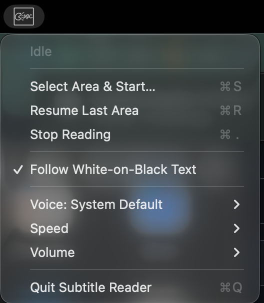

# 
 Subtitle Reader 

## What is it?

- A macOS menu bar application that reads live text in a screen area you choose continuously until you stop it.
- Handy for dubbing English subtitles from foreign media.
- Runs on both Apple silicon and Intel Macs (macOS 13+) (No Xcode needed)

**Works best with white text on a black background. English only.**

## Install
1. Download [Subtitle-Reader-1.0.dmg](Subtitle-Reader-1.0.dmg), open it, and drag **Subtitle Reader** into the **Applications** folder.
2. On first launch, macOS warns that the app is from an unidentified developer (it is not notarized). Control-click the app in Applications, choose **Open**, then click **Open** again. On macOS 15 and later, go to **System Settings → Privacy & Security** and click **Open Anyway** instead.

## Grant permissions
Subtitle Reader reads text by capturing the area you select, so macOS requires **Screen Recording** permission. It needs no other permissions.

1. The first time you start reading, macOS asks for permission. Click **Open System Settings**.
2. In **System Settings → Privacy & Security → Screen Recording** (called **Screen & System Audio Recording** on macOS 15 and later), turn on **Subtitle Reader**.
3. Quit Subtitle Reader and open it again. The permission takes effect only after a relaunch.

If reading produces no speech, check that this switch is still on.

## Use
Subtitle Reader has no Dock icon or window. Click its icon in the **menu bar** at the top of the screen to open the menu:

| Menu item | What it does |
| --- | --- |
| **Idle** / **Reading aloud…** | Status line showing whether the app is reading. It can't be clicked. |
| **Select Area & Start…** (⌘S) | Dims the screen. Drag a rectangle over the subtitles to start reading, or press **Esc** to cancel. |
| **Resume Last Area** (⌘R) | Starts reading the area you selected last time again. |
| **Stop Reading** (⌘.) | Stops reading. |
| **Follow White-on-Black Text** | When checked, reads only the white-on-black text inside the area and ignores everything else. Recommended for subtitles. |
| **Voice** | Chooses the voice. Voices for your language are listed first; others are under **Other Languages**. |
| **Speed** | Chooses how fast it speaks, from **Slowest** (120 words per minute) to **Fastest** (320). |
| **Volume** | Sets the volume to 25%, 50%, 75% or 100%. |
| **Quit Subtitle Reader** (⌘Q) | Quits the app. |

Your voice, speed and volume choices are remembered between launches. A change takes effect from the next line, and if the app isn't reading, it says a short sample so you can hear it.

Source and build scripts: [assortedTooling/SubtitleReader](https://github.com/eric-r-xu/assortedTooling/tree/main/SubtitleReader).
